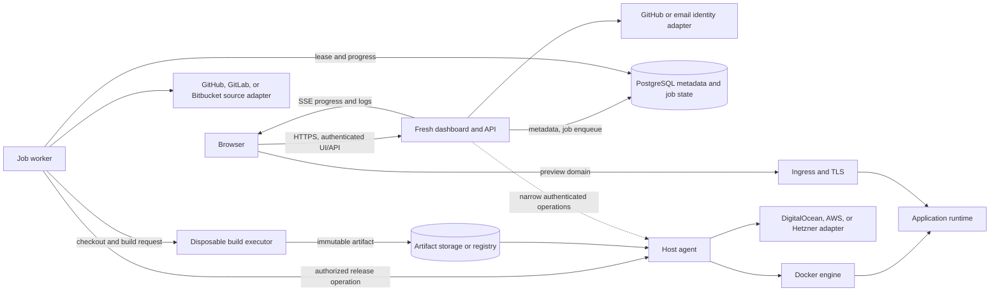
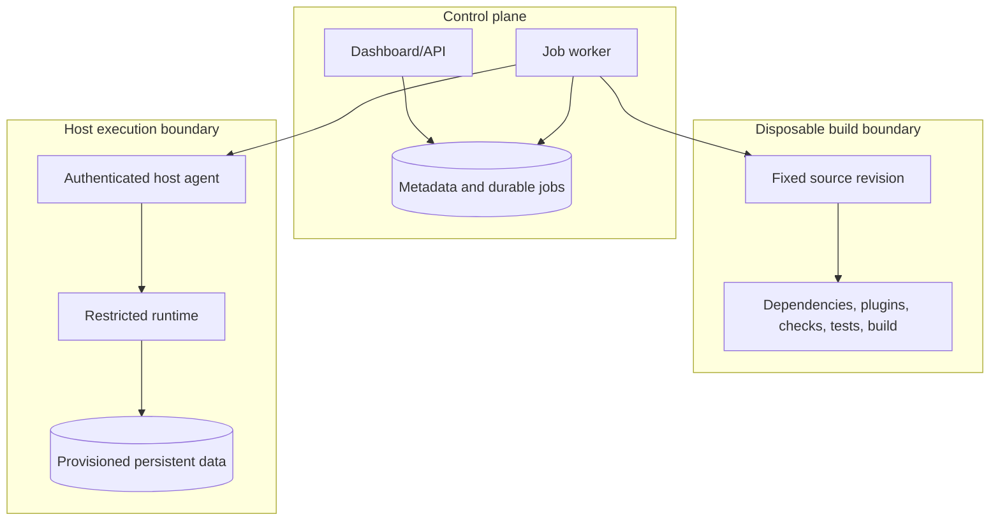

# dragonfruit Architectural Design

**Status:** Proposed architecture. Components and technologies below describe the intended direction in the README, not verified implementation choices. Items marked as open decisions require validation before production use.

## 1. Design Drivers

The architecture is organized around five requirements:

1. Keep the dashboard control plane separate from application build and runtime execution.
2. Make jobs durable and recoverable rather than tying deployment progress to a web request.
3. Treat every deployable output as an immutable, provenance-bearing artifact.
4. Preserve the healthy active release until a candidate has passed verification.
5. Scope credentials, network access, host operations, and persistent data explicitly.

The first target is trusted applications on a single Linux host. The system must not imply that this deployment topology is ready for unrelated public tenants.

## 2. Logical Architecture

The diagram shows conceptual boundaries, not a final network topology. In particular, the exact path for ingress control, log collection, artifact delivery, and infrastructure provisioning remains to be chosen. Integration provider lists are planned options, not a commitment that all providers are supported in the MVP.

## 3. Components and Responsibilities

| Component | Responsibilities | Boundary |
| --- | --- | --- |
| Dashboard/API | Fresh-rendered management UI, authentication, project authorization, configuration, deployment controls, audit initiation, and progress subscriptions. | Must not execute project code or receive unrestricted host/container control. |
| Identity adapters | Authenticate users through GitHub or the selected email sign-in mechanism. | Identity login does not grant repository access; exact email method and provider scopes are open decisions. |
| Source-control adapters | Connect GitHub, GitLab, and Bitbucket repositories; resolve revisions and support authorized Git operations. | Provider credentials are separate from identity credentials, narrowly scoped, revocable, and withheld from builds unless explicitly needed. |
| Metadata store | Users/ownership, projects, environments, configuration revisions, jobs, builds, artifacts, deployments, domains, hosts, and audit events. | PostgreSQL is the proposed store; schema and migrations are not yet defined. |
| Durable job queue | Persist queued work, worker leases, retries, cancellation, and progress references. | README proposes PostgreSQL-backed queue for the initial implementation; queue semantics and locking strategy need validation. |
| Job worker | Coordinate source freezing, build policy, artifact registration, candidate startup, verification, promotion, and cleanup. | Separate Deno service; should be restartable and idempotent. |
| Build executor | Run dependency resolution, checks, tests, and production build against a fixed source revision. | Disposable, isolated environment with resource, network, mount, and credential constraints. |
| Artifact storage | Retain immutable source snapshots/build outputs; provide stable retrieval by digest. | Object storage and/or container registry are proposed; choice is open. |
| Host agent | Execute narrow authorized operations to start, stop, and inspect releases; report observed state. | Authenticated Deno service mediates Docker operations; no general shell API or Docker socket exposed to the dashboard. |
| Container runtime | Build and execute application containers within limits and with only declared configuration, secrets, network, and storage. | Docker is the planned initial containerization backend. Docker alone is not considered a sufficient isolation boundary for public tenants. |
| Infrastructure adapters | Provision or manage the supported Linux host and related infrastructure lifecycle. | DigitalOcean, AWS, and Hetzner are planned options behind a common contract. Select one for the private MVP; managed application platforms are a separate adapter category. |
| Ingress | Terminate TLS, route hostnames, forward WebSockets where needed, and switch traffic during promotion. | Caddy or nginx are proposed alternatives; final choice is open. |
| Secrets facility | Store protected values and issue scoped references to authorized build/runtime contexts. | Encryption key is stored separately from PostgreSQL; exact key management is open. |

Fresh server rendering supplies the dashboard shell. Preact islands support interactive controls, editors, and log views. Shared TypeScript contracts should describe jobs, events, configuration, and release operations across the dashboard, worker, and agent.

## 4. Trust and Execution Boundaries

Build inputs are untrusted code execution even when they originate in a known repository: dependency scripts, plugins, configuration, checks, and tests all run. Deno permissions are defense in depth, not the sole isolation mechanism. OS-level isolation must constrain subprocesses, native dependencies, resource use, filesystem access, and network access.

Docker is the planned container lifecycle mechanism, but containerization does not by itself establish a sufficient isolation boundary for public multi-tenant workloads. The host agent mediates Docker operations; no browser-facing component receives access to the Docker socket. The build executor and runtime must still enforce unprivileged identities, limits, mount restrictions, network policy, and credential separation.

The dashboard is a control-plane service. It must never mount or expose a general host-control interface to browser-facing code. The host agent exposes a small, authenticated operation set and validates project/release authorization for each request. Builds receive only short-lived, scoped credentials needed for dependency access; production secrets are delivered only to the intended runtime and never to untrusted branch builds.

Preview applications run on a separate domain and cookie boundary from the dashboard. This limits the impact of application-controlled content and prevents preview cookies from sharing the dashboard's trust context.

## 5. Deployment Data Flow

1. **Request:** The dashboard authenticates the user, authorizes the project/environment operation, records an audit event, creates a durable job, and returns a job identifier without waiting for the build.
2. **Claim:** A worker claims the job with an expiring lease and records progress. The worker may resume or safely retry after lease expiry.
3. **Freeze:** The worker resolves an exact Git commit or snapshots an editor revision. All subsequent stages refer to that immutable input.
4. **Prepare and build:** A disposable executor receives the source, pinned toolchain, declared policy, and narrowly scoped build credentials. It installs dependencies, runs configured validation, and builds under time and resource limits.
5. **Register artifact:** A successful output is packaged with all runtime requirements, hashed, retained, and associated with source revision, toolchain, and build outcome. Secret values are excluded.
6. **Start candidate:** The worker asks the host agent to start a candidate release with the target configuration revision, secret-version references, resource limits, and declared storage.
7. **Verify:** The platform checks startup, readiness, and a smoke request. Failure marks the candidate unhealthy/rejected and leaves ingress on the active release.
8. **Promote:** A per-environment ordering/serialization rule ensures a stale deployment cannot promote after a newer one. Ingress switches traffic to the verified candidate; the prior release is drained within a defined timeout.
9. **Observe and reconcile:** Runtime health and desired state are recorded independently of job state. A reconciler compares metadata with host observations and repairs or flags drift.
10. **Retain and clean:** Artifacts remain available under retention policy for rollback. Expired execution resources and logs are cleaned without deleting persistent application data.

Rollback is a new operation that selects an existing compatible artifact and configuration revision. It does not rerun the build. Database migrations are outside automatic application rollback and require separate coordination.

## 6. State, Idempotency, and Concurrency

Job state represents work progress: `queued`, `running`, `succeeded`, `failed`, or `cancelled`. Runtime state represents observed service health: `starting`, `ready`, `unhealthy`, or `stopped`. These must remain distinct in storage and UI; a successful build job does not imply a healthy runtime.

The deployment orchestrator needs durable transition records and idempotency keys or equivalent deduplication for external operations. Retries must not create duplicate active releases. Promotion must be serialized per environment or guarded with a monotonically increasing deployment generation so delayed work cannot overwrite newer desired state.

Worker leases need explicit expiry and recovery rules. Cancellation must be observable and must terminate the complete build process tree, release temporary resources, and leave any active production release untouched. A reconciler is responsible for detecting cases where a worker or host agent completed an external side effect but failed to record it.

The exact job schema, lease protocol, retry/backoff policy, state transition table, and outbox strategy are open implementation decisions. They must be tested under worker and host-agent restarts.

## 7. Data and Storage Architecture

| Data class | Proposed location | Lifecycle |
| --- | --- | --- |
| Users, memberships, projects, environments, jobs, deployments, domains, hosts, audit events | PostgreSQL | Transactional metadata; migrate and back up. |
| Durable queue and worker progress | PostgreSQL-backed queue initially | Lease and retry state persists across worker restart. |
| Source snapshots and build outputs | Object storage and/or container registry | Immutable, digest-addressed, retention controlled. |
| Workspace files | Persistent workspace storage (later phase) | Mutable; revisioned independently from production artifacts. |
| Runtime root filesystem | Container/runtime storage | Replaceable with a release; not the location for durable application data. |
| Persistent application data | Explicit volumes or external services | Survives restart and release replacement; backed up under a defined policy. |
| Secrets | Encrypted secret store or encrypted metadata representation | Values protected; encryption key held separately; access versioned and scoped. |
| Logs | Retained log storage (implementation open) | Bounded retention, authorized access, secret-safe output policy. |

Backups must include PostgreSQL, persistent application data, and the material required to restore encrypted configuration. Backup restoration must be exercised. Artifact retention and application-data backup are different responsibilities: retaining an image does not back up a database or volume.

## 8. Application Adapter Boundary

The Fresh adapter converts a versioned dragonfruit application manifest into validated build and runtime operations. It owns framework-specific details such as supported Fresh version range, expected tasks, build output discovery, and required runtime files. The generic orchestration layer owns job state, isolation policy, artifact identity, candidate lifecycle, and ingress promotion.

The first adapter targets pinned Deno and tested Fresh 2 versions. Fresh 2 uses Vite and produces a `_fresh` directory containing generated server output; packaging must include applicable assets and runtime dependencies. Fresh 1 requires a separate adapter or migration path. Managed hosting (such as Deno Deploy) should be a later provider adapter only after lifecycle, API coverage, credential scope, quotas, and account ownership are validated.

The proposed manifest is not an extension to `deno.json`. Its schema version, parser, compatibility policy, and validation UX need to be finalized before implementation.

### Identity and source-control adapters

GitHub and email are planned user-authentication methods. GitHub may also be used for repository access, but identity login and source-control authorization must use distinct scopes and data flows. Email sign-in method remains open. Source-control adapters for GitHub, GitLab, and Bitbucket resolve a selected ref to an immutable commit before the worker starts a build. Webhook signatures are verified before events can enqueue work. Provider tokens are encrypted, revocable, and never written to job logs or artifact metadata.

### Container and infrastructure adapters

Docker is the planned container backend for the initial Linux deployment target. Docker operations are exposed only through the authenticated host agent and a narrow release-scoped operation set. The host agent, not the dashboard, owns the Docker integration.

DigitalOcean, AWS, and Hetzner are planned infrastructure adapters that provide host lifecycle and provider-specific resource operations behind a shared interface. The private MVP selects one provider; remaining integrations are added only after the common contract and failure behavior are validated. These infrastructure providers are distinct from managed application platforms such as Deno Deploy, whose application lifecycle requires a separate adapter.

## 9. API and Event Boundaries

The dashboard accepts user intent and creates durable work; it does not synchronously perform long-running builds. API responses should return stable project/job/deployment identifiers and current observed states. Exact route names and payload schemas are intentionally not specified here.

Server-sent events are proposed for job progress and log streaming. Streams require the same project authorization as API reads, bounded buffering, reconnection behavior, and retention limits. WebSockets are reserved for interactive development sessions and preview hot reload where needed. A stream connection must not become the only record of job progress; durable state remains queryable after disconnect or completion.

Dashboard-to-agent communication must be authenticated and narrow. The agent must reject operations against releases outside its authorization scope. Credentials for agent communication must not be exposed to browser clients.

## 10. Failure Handling

| Failure | Required behavior |
| --- | --- |
| Validation/build fails | Mark job failed, retain actionable logs, discard temporary executor resources, do not alter active release. |
| Worker exits during a job | Lease expires; another worker recovers or retries without duplicate active release. |
| Candidate does not become ready | Mark candidate unhealthy/rejected; keep ingress on the active release; retain diagnostic information. |
| Promotion request races with newer deploy | Reject or supersede stale promotion using per-environment ordering. |
| Host agent unavailable | Keep durable job state, retry within policy, expose delayed/failure state; do not falsely report readiness. |
| Runtime crashes after promotion | Record unhealthy observed state and surface it; recovery/restart policy must be defined without losing persistent data. |
| Cancellation during build | Terminate process tree, clean temporary resources, record cancelled outcome; preserve active release. |
| Ingress switch fails | Reconcile actual route and desired release; avoid reporting promotion success until observed. |
| Database migration is incompatible | Application rollback alone is insufficient; require explicit migration/recovery procedure and compatible schema strategy. |

## 11. Observability and Operations

The dashboard must expose job progress, build logs, deployment history, runtime health, resource usage, application errors, domain verification, and certificate status as these capabilities arrive in the MVP. Job logs and runtime logs should be distinguished. Events and audit records must avoid secret values and should carry correlation identifiers linking job, build, artifact, deployment, and runtime instance.

Operational readiness requires database, artifact, ingress, host-agent, and runtime health signals; alerts for failed or stuck jobs and unhealthy active applications; and documented backup/restore and host-recovery procedures. Numeric SLOs, alert thresholds, retention periods, and capacity targets remain open decisions.

## 12. Future Extension Boundaries

### Browser development

The workspace is mutable, persistent, and separately revisioned. Its files must not mutate a production artifact. The editor (Monaco or CodeMirror, to be selected) communicates with a workspace-scoped Deno language server. Preview execution is an isolated session with authentication, hot reload, idle expiry, and resource limits. A browser terminal is deferred until isolation and authorization are established.

### Visual authoring

Visual editing uses a versioned application model for supported pages, layouts, components, forms, validation, bindings, and server actions. Code generation is constrained to supported Fresh patterns and has explicit generated-section ownership. Handwritten logic integrates through documented extension points; arbitrary TSX round-trip editing is out of scope.

### Hosting providers

Provider-specific lifecycle operations belong behind an adapter. A managed provider is not assumed equivalent to self-hosted execution; lifecycle, credentials, quotas, and ownership must be validated before selecting it.

## 13. Decisions Required Before Production

- Pin Deno/Fresh versions and verify the Fresh 2 packaging contract.
- Validate Docker deployment, daemon placement, image provenance, and define the isolation threat model.
- Define the shared infrastructure-provider contract and select one initial provider from DigitalOcean, AWS, or Hetzner.
- Define identity and source-control authorization boundaries, provider scopes, webhook validation, and credential revocation.
- Select ingress (Caddy or nginx) and test atomic/observable traffic promotion.
- Select artifact store/registry and log retention backend.
- Define authentication, organization/role policy, and secret/key management.
- Validate PostgreSQL queue locking, lease recovery, and ordering semantics.
- Define egress policy, dependency script approval, and private registry credentials.
- Define resource limits, timeouts, shutdown/drain behavior, retention, backup objectives, and restore drills.
- Define the host-agent protocol, identity, authorization, and reconciliation behavior.
- Validate GitHub, GitLab, and Bitbucket API coverage and scopes for repository selection, immutable revision resolution, and webhook delivery.
- Validate DigitalOcean, AWS, and Hetzner lifecycle APIs, credentials, quotas, account ownership, and operational failure modes before declaring each provider supported.

## 14. References

Use the official Fresh deployment, Docker deployment, islands, Deno security, subprocess, deployment options, and deployment CLI references listed in the repository README. Verify framework packaging and runtime behavior against the selected pinned versions during the execution prototype.
